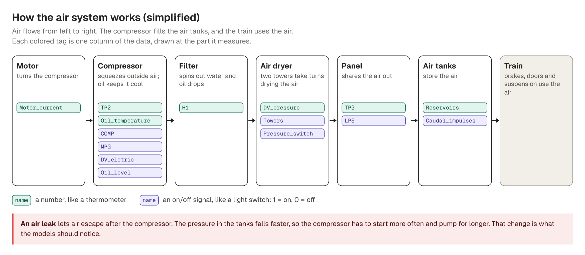

# Isolation Forest vs LSTM Autoencoder: How Early Can We Catch an Air Leak?

**Live demo:** [air-leak-watch.streamlit.app](https://air-leak-watch.streamlit.app) (replay the test months and see when each model raises its alarm)

A metro train in Porto, Portugal, has an air compressor: the Air Production Unit (APU). It makes the compressed air for the brakes, the doors and the suspension. Sensors on the compressor record its pressures, its oil temperature and its motor current, all day long. Between February and August 2020, the compressor had 4 air leaks.

An air leak works like a slow puncture in a bicycle tyre: the pressure drops faster, so the compressor has to pump more often and for longer. A model that watches the sensors could notice this early, and warn the maintenance team before the leak stops the train.

The problem: 4 leaks are far too few to learn what a leak looks like. So both models in this project learn only what a **healthy** compressor looks like, and raise an alarm when the sensors stop looking healthy:

| | Isolation Forest | LSTM autoencoder |
| --- | --- | --- |
| Type | classic machine learning | deep learning |
| Looks at | a summary of the last 60 minutes (averages, ranges, how the compressor pumps) | the raw readings of the last 60 minutes, one time step after another |
| Says "unusual" when | the hour is easy to separate from healthy ones | it cannot redraw the hour well |
| Learns from | healthy data only | healthy data only |

> **Main question:** trained only on healthy data, how early can each model warn before an air leak, and how many false alarms does it raise?

## How the models are judged

The split, the zones and the scoring were fixed in notebook 1.2, before anything else. The alarm rule and the limits were fixed in notebook 5.1 with February and March only, before any test window got a score.

- **Time split:** the models learn from February, the alarm limits are set on March (validation), and the models are tested on April to August. All 4 leaks are in the test months.
- **Warning zone:** an alarm in the 24 hours before a leak, or during the leak, counts as a warning for that leak. An earlier alarm is a false alarm.
- **Lead time:** how many hours the first warning came before the leak started.
- **False alarms:** alarms while the compressor is healthy, counted as events per week (see the alarm rule).
- **Alarm rule:** an alarm needs 3 windows in a row above the limit of the model. Alarms at most 60 minutes apart count as one event (notebook 5.1).
- **Alarm limit:** for each model, the lowest limit that gives at most 1 false alarm event per week in March, the healthy validation month. A week means a week of monitored time: the number of windows times 5 minutes. The locked limits are 0.7326 for Isolation Forest and 0.7800 for the LSTM autoencoder (notebook 5.1).
- **Unusual March hours:** March turned out to hold hours that are clearly not normal, although no failure is reported in March (notebook 3.2). They are left out when the alarm limits are set: the windows that touch a pump run of 30 minutes or more without a break, or a moment when `LPS` is on (the pressure fell below 7 bar). Neither ever happened in February. The test months are judged as described here, without any hours left out.
- **Ignored zone:** the 48 hours after the reported end of each leak. The official maintenance notes show that the repair can come more than a day after that end, so the compressor is not clearly healthy or broken in that time. Alarms there are not counted as right or wrong, but their number is reported.

The split and the 4 leaks with their zones are saved in [`results/time_split.csv`](results/time_split.csv) and [`results/leaks.csv`](results/leaks.csv) (notebook 1.2):

| Leak | Warning zone from | Leak start | Leak end | Ignored until |
| --- | --- | --- | --- | --- |
| 1 | 17 Apr 2020 00:00 | 18 Apr 2020 00:00 | 18 Apr 2020 23:59 | 20 Apr 2020 23:59 |
| 2 | 28 May 2020 23:30 | 29 May 2020 23:30 | 30 May 2020 06:00 | 1 Jun 2020 06:00 |
| 3 | 4 Jun 2020 10:00 | 5 Jun 2020 10:00 | 7 Jun 2020 14:30 | 9 Jun 2020 14:30 |
| 4 | 14 Jul 2020 14:30 | 15 Jul 2020 14:30 | 15 Jul 2020 19:00 | 17 Jul 2020 19:00 |

## Results

The test months (April to August 2020) were scored once, in notebook 5.2, with the alarm rule and the limits locked in notebook 5.1. Notebook 5.3 then looked inside every alarm.

| | Isolation Forest | LSTM autoencoder |
| --- | --- | --- |
| Leaks caught (of 4) | 1 | 4 |
| First alarm, leak 1 | missed | 1.6 h after the start |
| First alarm, leak 2 | missed | at the start |
| First alarm, leak 3 | 3.4 h after the start | 0.2 h after the start |
| First alarm, leak 4 | missed | **13.4 h before the start** |
| False alarm events in 14.8 healthy weeks | 8 (0.54 per week) | 21 (1.42 per week) |
| Alarms in the ignored zones | 1 | 45 |
| Locked limit | 0.7326 | 0.7800 |

The full results are in [`results/test_results.csv`](results/test_results.csv). Every alarm event, with what the compressor did and its top signals, is in [`results/alarm_events.csv`](results/alarm_events.csv).

**What this means**

- **Neither model wins on every line.** The LSTM autoencoder caught all 4 leaks, but it raised more false alarms than the budget of 1 per week that set its limit in March. Isolation Forest stayed within that budget, but caught only leak 3, after its start.
- **Caught is not the same as early.** Only leak 4 got a real early warning. Leaks 1 to 3 were noticed at their start or soon after: before them, the compressor behaved like on a healthy day, so there was nothing to see. Before leak 4, the tank pressure dropped several times faster while the pump rested, and the pump started far more often: the slow puncture. The LSTM saw this in the signals that follow the pump (notebook 5.3).
- **Why Isolation Forest missed most leaks.** During a leak the pump runs nonstop and the tank pressure stops rising. Isolation Forest does see that these hours are unusual, but its score has a ceiling (notebook 4.1): during the leaks it stays just under its limit. The error of the LSTM has no ceiling: during leaks 1 to 3 it was almost 4 times its limit, and about half of it came from `DV_pressure`, which is up during long pump runs and never was in February (notebook 5.3).
- **What the false alarms are** (notebook 5.3): hours in which the pump never rested (the largest LSTM events, and 6 of the 8 Isolation Forest events), moments with the tanks below 7 bar, hours with more pumping than usual (LSTM only), and one stretch of frozen readings (LSTM only).

**Limitations**

- **"Healthy" only means that no leak was reported.** The false alarms in which the pump never rested look just like the reported leaks, and so do the unusual March hours (notebook 3.2). If some of them were air losses that nobody reported, some "false" alarms were right after all, and the limits set on March may be stricter than needed. The results above still count them as false, as the rules say. Notebook 5.4 shows what looser limits would have given.
- **Frozen readings.** In 5.8% of the test windows (8 stretches), none of the analog readings moved for hours; February and March have none. Most of the watched warning zone of leak 1 is frozen, and one long false alarm of the LSTM comes from frozen readings (notebook 5.2).
- **Only 4 leaks.** Each lead time rests on a single leak, so the table shows what happened in 2020, not a promise for the next leak.

**Other limits and speed** (notebook 5.4: a what-if after the test, which changes no result above)

- **A looser budget buys the LSTM no earlier warning.** With 2 or 4 false alarms per week allowed in March, its limit is lower and it raises more false alarms in the test months, but leaks 1 to 3 are still noticed at about their start, and the warning before leak 4 stays about the same. With a stricter budget (0.5 per week), that warning shrinks to a short one. So the locked budget sits right where the long warning appears. This was not chosen: it can only be seen after the test, and it rests on a single leak.
- **Isolation Forest barely moves.** Its limits stay squeezed under the ceiling of its score: looser budgets give it only a short warning before leak 4, and it still misses most leaks.
- **Leaving the unusual March hours out mattered.** With every March window counted (the what-if of notebook 5.1), the LSTM limit is far higher: the fewest false alarms, but leak 4 is missed.
- **If the hours in which the pump never rested were air losses,** most false alarms of Isolation Forest would have been right; the LSTM would still be above its budget.
- **Speed is not the issue.** Both models score one window in milliseconds, and a new window comes every 5 minutes.

What every budget gave is in [`results/tradeoff.csv`](results/tradeoff.csv).

## Demo

A small Streamlit app replays the test months the way both models saw them. It runs no model: it reads the saved results of the notebooks.

- **Replay:** pick a moment (one of the 4 leaks, or one of the 4 kinds of false alarms) and press Play. Every 5 minutes of 2020 bring a new window: the tank pressure, the pump and the air dryer, the score of Isolation Forest and the error of the LSTM with their limits, which model raises an alarm, and which signals made the window look unusual. A switch shows or hides the reported leaks, so you can also watch without knowing when they come.
- **Results:** the results above, every alarm event of the test months, and what other limits would have given (notebook 5.4).
- **How it works:** the air system, and the four steps from the readings to an alarm.

To open it on your computer, see [How to run](#how-to-run), step 4.

**Online.** The app also runs at [air-leak-watch.streamlit.app](https://air-leak-watch.streamlit.app), on [Streamlit Community Cloud](https://streamlit.io/cloud), for free. It only reads saved files, so it needs no GPU and no PyTorch: `app/requirements.txt` lists the few libraries the cloud installs. An app without visitors for 12 hours goes to sleep; the next visitor wakes it with one click.

## Dataset

[MetroPT-3](https://archive.ics.uci.edu/dataset/791/metropt+3+dataset) by Davari, Veloso, Ribeiro and Gama (2021), from the UCI Machine Learning Repository ([doi:10.24432/C5VW3R](https://doi.org/10.24432/C5VW3R)). License: CC BY 4.0; the notebooks of this project process the data. It has 15 signals of one compressor, from February to August 2020, and a list of the 4 air leaks. The column descriptions and the list of air leaks come from `Data Description_Metro.pdf`, which is part of the download.

### What is inside the raw data (notebook 1.1)



- **7 numbers** (analog signals): 5 pressures in bar (`TP2`, `TP3`, `H1`, `DV_pressure`, `Reservoirs`), the oil temperature in °C and the motor current in A.
- **8 on/off signals** (digital, 0 or 1): the valves, the switches and the two dryer towers (`COMP`, `DV_eletric`, `Towers`, `MPG`, `LPS`, `Pressure_switch`, `Oil_level`, `Caudal_impulses`).
- **1,516,948 rows**, from 1 February 2020 00:00 to 1 September 2020 03:59. The compressor was logged at 1 Hz, and the file keeps one of every 10 readings, so there is one row about every 10 seconds.
- **No missing values** and no repeated rows or times. There are **gaps** when the train is switched off, mostly at night.

Notebook 1.1 explains every column in simple words, and checks the file against its description (24 checks).

### What the compressor looks like in February and March (notebooks 2.1 and 3.2)

- The compressor works in **pump cycles**. It rests while the train uses air and the tank pressure falls from about 10 to about 8 bar, then it pumps for about 2 minutes to fill the tanks again. A full cycle takes about 26 minutes (median).
- In the first half of March the compressor pumped clearly more often, with longer pump phases and a faster pressure drop between them. All through March the oil temperature swung more within an hour and the tanks filled more slowly. No leak is reported in March.
- March also has **hours that February never had** (notebook 3.2). In 5 stretches, the longest 20.6 hours, the pump ran without a break while the tank pressure barely rose; in February the pump never ran longer than 4.2 minutes in one go. Three on/off signals that never move in February (`LPS`, `Oil_level`, `Caudal_impulses`) do move in March. A clue about the cause (notebook 5.1): after the train had been switched off, the tanks still held their air in February, but in March they had often lost most of it, which looks like air escaping somewhere. No failure is reported in March, so the cause stays unknown. When the alarm limits are set on March, these hours are left out (notebook 5.1).
- Decisions for the next steps: windows of **60 minutes** (a 30-minute window rarely holds a full pump cycle), the oil temperature as a **change** within the window (its level moves with the season and the workload), and **12 of the 15 signals**: the three signals that never change in February are left out of both models, because a model cannot learn from them what normal looks like (decided after notebook 3.2, applied in notebook 4.1).

## Project steps

| Step | Notebook | What it does | Status |
| --- | --- | --- | --- |
| 0. Setup | `0.1_check_environment` | checks Python, the library versions, and that PyTorch can use the GPU, also for an LSTM | done |
| 1. Data setup | `1.1_download_and_check_data` | gets MetroPT-3, explains every column, checks that the file is complete and correct (24 checks), and saves a smaller copy | done |
| | `1.2_split_and_label` | splits the time into train, validation and test, and labels every reading: healthy, warning zone, leak or ignored (17 checks) | done |
| 2. EDA | `2.1_explore_normal_behavior` | how a healthy compressor works (February and March only), and the window length | done |
| 3. Preprocessing | `3.1_make_windows` | cuts the data into 60-minute windows, one every 5 minutes (47,491 complete windows): 46 summary numbers per window for Isolation Forest, and the scaled readings on a 10-second grid for the LSTM (14 checks) | done |
| | `3.2_check_windows` | rebuilds 90 random windows slowly from the raw readings and gets the same numbers, checks the parts and the scaling, compares February with March, and finds the March hours that February never had (13 checks) | done |
| 4. Modeling | `4.1_train_isolation_forest` | shows how Isolation Forest cuts unusual windows away, trains it on February with the 40 summary numbers of the 12 kept signals, scores February and March, and saves the model (8 checks) | done |
| | `4.2_train_lstm_autoencoder` | trains the LSTM autoencoder on the GPU: it learns to redraw February windows (360 ticks of the 12 kept signals), stops early on the March error, and saves the model (10 checks) | done |
| 5. Evaluation | `5.1_set_alarm_rules` | turns scores into alarms (3 windows in a row, nearby alarms as one event), marks the unusual March hours, and locks the limit of each model on March: the lowest one with at most 1 false alarm per week (10 checks) | done |
| | `5.2_test_results` | opens the test months with the locked rules: leaks caught, lead time, false alarms per week, and the stretches of frozen readings (9 checks) | done |
| | `5.3_why_alarms` | shows which signals made each alarm go off (the error of every signal for the LSTM, SHAP values for Isolation Forest), what the compressor did, the early warning of leak 4, and four kinds of false alarms (10 checks) | done |
| | `5.4_tradeoff_and_speed` | sets the limits again with other budgets (0.5 to 4 false alarms per week in March) and with every March window counted, shows what each gives in the test months, and times one window per model (7 checks) | done |
| 6. Demo | `6.1_prepare_demo` | prepares the two small files of the dashboard: the readings of the test months minute by minute, and the SHAP parts of the forest for every test window (7 checks) | done |
| | `app/app.py` | the dashboard (Streamlit): Replay, Results and How it works | done |

## Folder structure

```
predictive-maintenance-metropt/
├── data/
│   ├── raw/                          <- MetroPT-3 from UCI: the CSV and its description PDF (not in this repo, see How to run)
│   └── processed/                    <- made by the notebooks (not in this repo)
│       ├── metropt3.parquet          <- notebook 1.1: the same table, smaller, with the column types kept
│       ├── labels.parquet            <- notebook 1.2: the part and the zone of every reading
│       ├── windows.parquet           <- notebook 3.1: one row per window, with its 46 summary numbers
│       └── grid.npz                  <- notebook 3.1: the readings on a 10-second grid, scaled for the LSTM
├── notebooks/
│   ├── 0_setup/
│   │   └── 0.1_check_environment.ipynb
│   ├── 1_data_setup/
│   │   ├── 1.1_download_and_check_data.ipynb
│   │   └── 1.2_split_and_label.ipynb
│   ├── 2_eda/
│   │   └── 2.1_explore_normal_behavior.ipynb
│   ├── 3_preprocessing/
│   │   ├── 3.1_make_windows.ipynb
│   │   └── 3.2_check_windows.ipynb
│   ├── 4_modeling/
│   │   ├── 4.1_train_isolation_forest.ipynb
│   │   └── 4.2_train_lstm_autoencoder.ipynb
│   ├── 5_evaluation/
│   │   ├── 5.1_set_alarm_rules.ipynb
│   │   ├── 5.2_test_results.ipynb
│   │   ├── 5.3_why_alarms.ipynb
│   │   └── 5.4_tradeoff_and_speed.ipynb
│   └── 6_demo/
│       └── 6.1_prepare_demo.ipynb
├── models/
│   ├── isolation_forest.joblib       <- notebook 4.1: the trained Isolation Forest
│   └── lstm_autoencoder.pt           <- notebook 4.2: the trained LSTM autoencoder
├── results/
│   ├── time_split.csv                <- notebook 1.2: train, validation and test
│   ├── leaks.csv                     <- notebook 1.2: the 4 leaks with their zones
│   ├── signals_used.json             <- notebook 4.1: the 12 signals both models use
│   ├── lstm_training_history.csv     <- notebook 4.2: the errors after every round of training
│   ├── alarm_rules.json              <- notebook 5.1: the alarm rule and the locked limits of both models
│   ├── window_scores.parquet         <- notebook 5.2: the score, error and alarms of every window
│   ├── test_results.csv              <- notebook 5.2: the test results of both models
│   ├── alarm_events.csv              <- notebook 5.3: every alarm event, with what the compressor did and its top signals
│   └── tradeoff.csv                  <- notebook 5.4: what other budgets would have given in the test months
├── images/
│   └── air_system.png                <- the drawing of the air system in this README and in the app
├── app/
│   ├── app.py                        <- the dashboard (Streamlit): Replay, Results, How it works
│   ├── requirements.txt              <- the few libraries the online app needs
│   └── data/                         <- notebook 6.1: the two small files of the app
│       ├── readings.parquet          <- what the compressor did in the test months, minute by minute
│       └── forest_parts.parquet      <- why the forest scored each test window (SHAP per signal)
├── .streamlit/
│   └── config.toml                   <- the colors of the app
├── README.md
├── requirements.txt                  <- libraries, with exact versions
├── requirements-torch.txt            <- PyTorch with GPU support
└── .gitignore
```

## Setup (Windows)

This is done once per computer. Type the commands in the terminal of VS Code (**Terminal > New Terminal**), which opens in the project folder. Every command calls the Python inside `.venv` directly, so the environment does not need to be "activated".

1. **Check the NVIDIA driver.** Run `nvidia-smi`. It shows your GPU, and at the top right `CUDA Version`. That number must be 13.0 or higher. If it is lower, or the command is not found, update the driver (NVIDIA App > Drivers), restart the laptop and check again.
2. **Make a virtual environment with Python 3.14** (a private Python for this project, in the folder `.venv`). Use the path of your Python 3.14, for example:
   ```
   C:\Python314\python.exe -m venv .venv
   ```
3. **Update pip** (the tool that installs libraries):
   ```
   .venv\Scripts\python.exe -m pip install --upgrade pip
   ```
4. **Install the libraries:**
   ```
   .venv\Scripts\python.exe -m pip install -r requirements.txt
   ```
5. **Install PyTorch with GPU support** (a large download):
   ```
   .venv\Scripts\python.exe -m pip install -r requirements-torch.txt
   ```
   This file downloads PyTorch from the PyTorch website, because the normal package site only has the CPU-only build of PyTorch for Windows. If pip cannot find this version, open [pytorch.org/get-started/locally](https://pytorch.org/get-started/locally/), choose Windows, Pip, Python and the newest CUDA, and copy the `--index-url` it shows into `requirements-torch.txt`.
6. **Choose the kernel in VS Code.** Open a notebook, click **Select Kernel** at the top right, then **Python Environments**, then `.venv`.
7. **Run `notebooks/0_setup/0.1_check_environment.ipynb`.** It must end with **ALL CHECKS PASSED**. If not, its last section says what to do.

Library versions are pinned in `requirements.txt` and `requirements-torch.txt`, and notebook 0.1 checks that the installed versions match.

## How to run

1. Do the Setup above once.
2. Get the data. If it is not in `data/raw/` yet, notebook 1.1 downloads it from UCI. You can also download it yourself: open the [MetroPT-3 page](https://archive.ics.uci.edu/dataset/791/metropt+3+dataset), click **Download**, and put the zip file in `data/raw/`, or unzip it there (the CSV and the PDF). Do not open the CSV in Excel and save it: notebook 1.1 checks that the file is exactly the original.
3. Run the notebooks in the order of [Project steps](#project-steps). In VS Code, use **Restart** and then **Run All** for each notebook, so no old result stays on screen. Notebooks with checks (0.1, 1.1, 1.2, 2.1, 3.1, 3.2, 4.1, 4.2, 5.1, 5.2, 5.3, 5.4, 6.1) must end with **ALL CHECKS PASSED**. Notebook 4.2 trains on the GPU; on a GPU, two runs can differ slightly in the last digits.
4. Open the dashboard. In the terminal of VS Code, in the project folder:
   ```
   .venv\Scripts\python.exe -m streamlit run app/app.py
   ```
   Then open the Local URL it prints (http://localhost:8501) in your browser. Stop the app with Ctrl+C in the terminal.

Developed on a Windows laptop with an Intel Core Ultra 7 255HX, an NVIDIA GeForce RTX 5070 Laptop GPU (8 GB VRAM) and 32 GB RAM.
